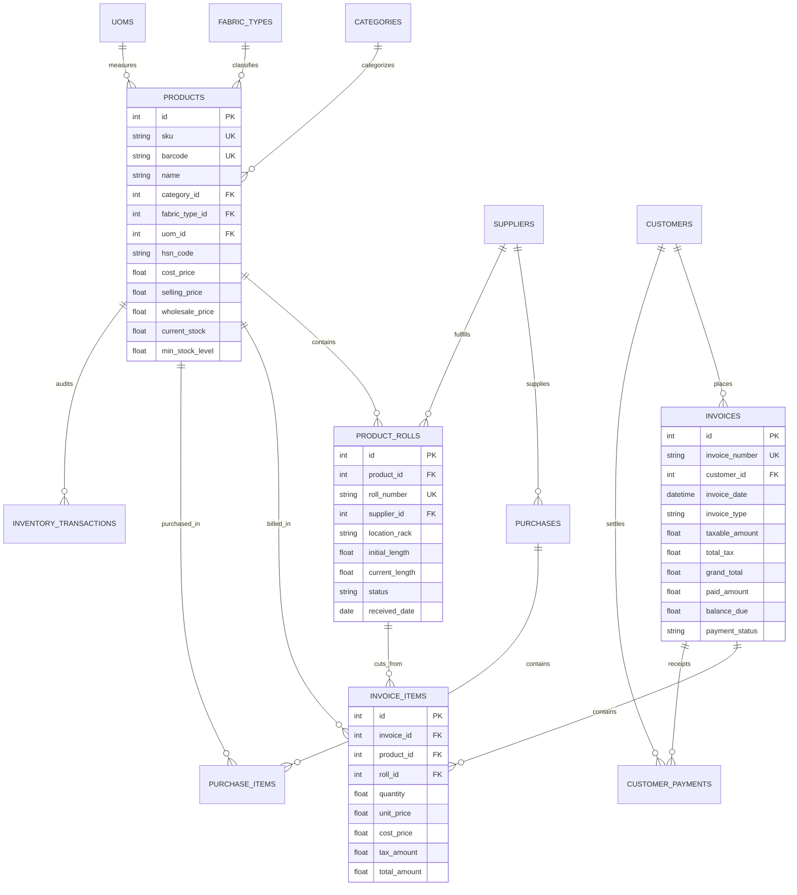

# 🧵 Textile Store Management System (TEXPRO ERP & POS)

[](https://textile-store-management-system.vercel.app)
[](https://nodejs.org/)
[](https://expressjs.com/)
[](https://www.sqlite.org/)
[](LICENSE)
[]()

🌐 **Live Production App**: **[https://textile-store-management-system.vercel.app](https://textile-store-management-system.vercel.app)**

> A high-performance, enterprise-grade Textile Store Management System engineered with a **Third Normal Form (3NF) relational database schema**, an **ACID-compliant inventory & POS billing engine**, and an interactive **SQL Analytics Workbench** executing complex relational queries with Common Table Expressions (CTEs) and Window Functions.

---

## 🌟 Executive Highlights

* **Industry-Specific Textile Modeling**: Native support for **Roll / Bale / Batch tracking**, fractional decimal cut measurements (e.g., $2.75\text{ m}$), fabric composition (Combed Cotton, Pure Silk, Belgian Linen, Micro Velvet), GSM, weave specifications, and rack locations.
* **Full CRUD Point of Sale (POS) Billing Engine**:
  * Barcode scanning & live SKU lookup.
  * Real-time stock validation and atomic deduction from physical rolls.
  * Multi-tier pricing: **Retail vs Wholesale B2B**.
  * Dual Tax computation (Intrastate CGST + SGST vs Interstate IGST).
  * Dual invoice layout: **A4 GST Tax Invoice** and **80mm Thermal Receipt**.
* **Khata & Customer Credit Ledger**: Complete balance tracking, credit limit enforcement, partial billing, and payment settlement receipt generation.
* **Supplier & Stock Inward (GRN)**: Inward fabric bolts, update cost prices, and allocate rolls to warehouse racks.
* **Complex SQL Analytics**: 7 showcase advanced SQL queries calculating inventory valuation matrices, dead-stock age risk, billing velocity, and customer risk categorizations.
* **Responsive Modern UI**: Built with semantic HTML5, CSS custom properties, responsive Flex/Grid layouts, Chart.js visualizations, and native `<dialog>` modals.

---

## 🏗️ System Architecture & Relational Database Design (3NF)

The database schema is strictly normalized to **Third Normal Form (3NF)** with explicit foreign keys, check constraints, indexes, and analytical views.

### Relational Schema Diagram



---

## ⚡ Showcase: Complex SQL Queries & Analytics

All queries are executed directly on the live database via the backend analytics engine and viewable in the **SQL Workbench**:

### 1. Multi-Dimensional Inventory Valuation Matrix
Aggregates inventory valuation, potential sales yield, and profit margins across fabrics and categories:
```sql
SELECT 
    c.name AS category_name,
    f.name AS fabric_name,
    COUNT(p.id) AS total_products_count,
    ROUND(SUM(p.current_stock), 2) AS total_stock_quantity,
    ROUND(SUM(p.current_stock * p.cost_price), 2) AS total_inventory_cost_value,
    ROUND(SUM(p.current_stock * p.selling_price), 2) AS total_potential_sales_value,
    ROUND(SUM(p.current_stock * (p.selling_price - p.cost_price)), 2) AS projected_gross_margin,
    ROUND((SUM(p.current_stock * (p.selling_price - p.cost_price)) / 
           NULLIF(SUM(p.current_stock * p.selling_price), 0)) * 100, 2) AS profit_margin_percent,
    SUM(CASE WHEN p.current_stock <= p.min_stock_level THEN 1 ELSE 0 END) AS low_stock_item_count
FROM products p
JOIN categories c ON p.category_id = c.id
JOIN fabric_types f ON p.fabric_type_id = f.id
WHERE p.is_active = 1
GROUP BY c.name, f.name
ORDER BY total_inventory_cost_value DESC;
```

### 2. Fabric Roll Aging & Dead-Stock Detection (CTE & Julian Days)
Identifies fabric rolls stagnating on storage racks with zero movement in 60+ days:
```sql
WITH RollMovement AS (
    SELECT 
        r.id AS roll_id,
        r.roll_number,
        p.name AS product_name,
        r.location_rack,
        r.initial_length,
        r.current_length,
        ROUND(r.current_length * p.cost_price, 2) AS tied_up_capital,
        CAST((julianday('now') - julianday(r.received_date)) AS INTEGER) AS days_in_stock,
        COALESCE(
            (SELECT SUM(ii.quantity) 
             FROM invoice_items ii 
             JOIN invoices inv ON ii.invoice_id = inv.id 
             WHERE ii.roll_id = r.id 
               AND julianday('now') - julianday(inv.invoice_date) <= 60), 
            0
        ) AS sales_last_60_days
    FROM product_rolls r
    JOIN products p ON r.product_id = p.id
    WHERE r.status IN ('FULL', 'IN_USE')
)
SELECT 
    roll_number, product_name, location_rack, current_length, initial_length,
    ROUND((current_length / initial_length) * 100, 1) AS remaining_pct,
    days_in_stock, sales_last_60_days, tied_up_capital,
    CASE 
        WHEN days_in_stock > 90 AND sales_last_60_days = 0 THEN 'CRITICAL_DEAD_STOCK'
        WHEN days_in_stock > 60 AND sales_last_60_days < 5 THEN 'SLOW_MOVING'
        WHEN days_in_stock <= 30 THEN 'FAST_FRESH_STOCK'
        ELSE 'NORMAL_CYCLE'
    END AS stock_health_status
FROM RollMovement
ORDER BY days_in_stock DESC, tied_up_capital DESC;
```

### 3. Daily Billing Trajectory & 7-Day Rolling Average (Window Functions)
Computes cumulative revenue trajectory and moving averages using `SUM() OVER` and `ROWS BETWEEN 6 PRECEDING`:
```sql
WITH DailyBilling AS (
    SELECT 
        date(invoice_date) AS billing_date,
        COUNT(id) AS total_bills_count,
        ROUND(SUM(subtotal), 2) AS gross_subtotal,
        ROUND(SUM(grand_total), 2) AS daily_grand_total,
        ROUND(AVG(grand_total), 2) AS average_basket_value
    FROM invoices
    WHERE payment_status != 'VOID'
    GROUP BY date(invoice_date)
)
SELECT 
    billing_date, total_bills_count, daily_grand_total, average_basket_value,
    ROUND(SUM(daily_grand_total) OVER (ORDER BY billing_date ASC), 2) AS cumulative_revenue_to_date,
    ROUND(AVG(daily_grand_total) OVER (
        ORDER BY billing_date ASC 
        ROWS BETWEEN 6 PRECEDING AND CURRENT ROW
    ), 2) AS rolling_7_day_average_sales
FROM DailyBilling
ORDER BY billing_date DESC;
```

---

## 🚀 Quickstart & Installation

### Prerequisites
* **Node.js**: v18+ or v20+
* **npm**: v9+

### 1. Clone & Install Dependencies
```bash
git clone <your-repo-url>
cd Textile
npm install
```

### 2. Initialize Database & Seed Domain Data
```bash
npm run seed
```

### 3. Run Automated Tests
```bash
npm test
```
*Executes all 17 integration tests verifying transactions, stock deductions, roll cuts, and complex SQL views.*

### 4. Start Development / Production Server
```bash
npm start
```
Open **[http://localhost:5000](http://localhost:5000)** in your browser.

---

## 🐳 Docker Deployment

Run the system in an isolated container with persistent storage:

```bash
# Build & start container
docker-compose up --build -d

# Check health status
docker ps
```
The application will be accessible at `http://localhost:5000`.

---

## ☁️ Cloud Deployment (Render / Railway)

### Deploying to Render
1. Push this repository to GitHub or GitLab.
2. In the Render Dashboard, select **New + Blueprint**.
3. Select your repository. The included [`render.yaml`](file:///d:/Textile/render.yaml) automatically provisions the web service, installs dependencies, runs the database migration, and configures health checking!

---

## 📁 Project Structure

```
d:\Textile\
├── server.js               # Main Express application & API router
├── package.json            # Node.js dependencies & run scripts
├── Dockerfile              # Multi-stage production container
├── docker-compose.yml      # Local container orchestration
├── render.yaml             # Render 1-click cloud deployment blueprint
├── .gitignore              # Standard git exclusion rules
├── config/
│   └── db.js               # Promisified SQLite wrapper (WAL mode & foreign keys)
├── db/
│   ├── schema.sql          # 3NF DDL schema, foreign keys, indexes, analytical views
│   ├── seed.sql            # Realistic textile inventory, fabrics, rolls, customers & bills
│   ├── complex_queries.sql # Standalone reference of all 7 advanced SQL queries
│   └── initDb.js           # Automated schema runner & seeder
├── src/
│   ├── controllers/        # Express request controllers (CRUD & business logic)
│   ├── routes/             # REST API endpoint definitions
│   └── queries/            # Centralized SQL query definitions
├── public/                 # Responsive HTML/CSS/JavaScript Frontend
│   ├── index.html          # Single Page Application container
│   ├── css/
│   │   ├── style.css       # Design tokens, typography, cards, badges, modals
│   │   └── pos.css         # POS terminal, keypad, and A4/thermal print stylesheets
│   └── js/
│       ├── api.js          # REST client communicating with backend
│       ├── app.js          # Router, hotkeys, toast notification alerts
│       ├── dashboard.js    # Executive KPI cards & Chart.js visualizations
│       ├── pos.js          # POS terminal, real-time stock deduction, tax invoices
│       ├── inventory.js    # Fabrics catalog, roll rack inspector, stock adjustments
│       ├── billing.js      # Invoice history, filters, voiding with stock rollback
│       ├── customers.js    # Khata ledger, credit limits, payment receipts
│       ├── suppliers.js    # Mill directories, Goods Received Notes (GRN)
│       └── analytics.js    # Interactive SQL Analytics Workbench & query runner
└── tests/
    └── api.test.js         # Automated end-to-end integration test suite
```

---

## 📜 License
MIT License. Created for High & Pro Level Textile Store Operations.
